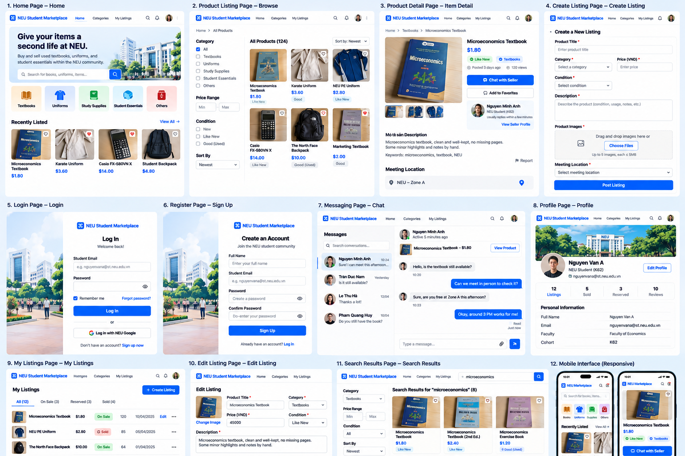

# NEU Student Marketplace

## Member

- **Trần Tuấn Anh** - 11247264
- Vũ Quốc Huy - 11247301
- Nguyễn Tuấn Anh - 11247264
- Mai Huy Đăng - 11247269

## Function

> A second-hand marketplace for NEU students to buy and sell used textbooks, Karate uniforms, sportswear, study supplies, and student essentials.

**MVP scope:** Guests can browse and search listings. Registered users can sign in, create listings with images, message sellers, and mark their listings as sold. **Out of scope:** online payment, delivery, AI recommendations, and Lost & Found.

## Approved UI reference



**This image is the mandatory visual reference.** Some bottom-row screens in this collage are cropped or too small to read. Do not infer extra features from unclear details. Follow [the design specification](docs/design.md) and [user flows](docs/user-flow.md) for functionality.

## Required reading before implementation

1. [Design specification and all screens](docs/design.md)
2. [Sitemap and user flows](docs/user-flow.md)
3. [Frontend/backend API contract](docs/api-contract.md)
4. [Four-person assignments, acceptance criteria and checklists](docs/tasks.md)
5. [Git, branching and pull request rules](docs/contributing.md)

**If using AI:** provide the mockup image, README, design specification, user flows, API contract and your assigned task section. Do not provide only the picture and let an AI invent the workflows.

## Technology stack

- **Frontend:** semantic HTML5, CSS3, vanilla JavaScript. Do not use React, Vue, Bootstrap or Tailwind without team approval. Follow the instructor's Weeks 2–5 material: HTML/forms/accessibility; CSS box model, Flexbox, Grid, media queries; JS DOM/events/validation; Fetch API, async/await, JSON, try/catch and CORS.
- **Backend:** Python, FastAPI, SQLite, following the introductory Week 6 approach (virtual environments, Uvicorn, `/docs`, frontend/backend separation). Application logic is designed by the team.
- **Images:** locally stored in `backend/uploads/` for the demo; the database stores image paths. Never commit users' uploads.
- **MVP chat:** REST endpoints with polling every few seconds while chat is open; no WebSocket required.
- **Payment and handoff:** students coordinate and transact outside the platform, preferably meeting in a public place.

## Repository layout

```text
neu-student-marketplace/
├── README.md
├── docs/
│   ├── images/marketplace-mockup.png
│   ├── design.md
│   ├── user-flow.md
│   ├── api-contract.md
│   ├── tasks.md
│   └── contributing.md
├── frontend/
│   ├── index.html                 # Homepage (FE1)
│   ├── pages/                    # Other HTML pages
│   ├── css/                      # Base, components, page styles
│   ├── js/                       # API adapter, mock data and page scripts
│   └── assets/                   # Licensed or original sample images
└── backend/
    ├── main.py
    ├── routers/
    ├── models/
    ├── schemas/
    ├── database.py
    ├── requirements.txt
    └── uploads/                  # Git-ignored
```

## Run locally

Use Python 3.11+ and two terminals. SQLite is included with Python; no separate database server is needed.

**Backend (macOS/Linux), from the repository root:**

```bash
cd backend
python3 -m venv .venv
source .venv/bin/activate
python -m pip install -r requirements.txt
python seed.py
python -m uvicorn main:app --reload --host 127.0.0.1 --port 8000
```

On Windows use `python -m venv .venv` and `.venv\Scripts\activate` instead. Seeding is optional and can be rerun: it creates two demo accounts, ten listings, images and a sample conversation. Both accounts use `DemoPass123!`: `buyer@example.com` and `seller@example.com`. These are local demo credentials only.

The database is created automatically at `backend/marketplace.db` on startup or seeding. Uploaded files are stored in `backend/uploads/`; both are ignored by Git. To start fresh, stop the backend, remove the local database, then rerun the seed command. [Backend configuration and endpoints](backend/README.md) documents alternate database/upload paths and session settings. There is no automatic migration system.

API health: <http://127.0.0.1:8000/api/health>. Interactive API documentation: <http://127.0.0.1:8000/docs>.

**Frontend, from the repository root in a second terminal:**

```bash
python3 -m http.server 5500 --bind 127.0.0.1 --directory frontend
```

Open <http://127.0.0.1:5500/index.html>. VS Code Live Server also works on port 5500, including when it serves the repository root at `/frontend/index.html`. Do not open HTML using `file://`; JavaScript modules, Fetch and browser storage need an HTTP origin.

## Real API and mock modes

The frontend defaults to **real API mode**. `frontend/js/api.js` uses port 8000 and the frontend's hostname. All API requests include session cookies; uploaded images use the same backend origin. Keep both servers on the same hostname: pair `127.0.0.1` with `127.0.0.1`, or `localhost` with `localhost`.

For isolated frontend testing, open the browser developer console on the frontend and run:

```js
localStorage.setItem('neu-marketplace-api-mode', 'mock');
location.reload();
```

Mock mode needs only the static frontend server. It uses fixture listings, demo accounts, browser storage for profiles/conversations, and IndexedDB for listing images/messages. Its data is separate from SQLite. The mode preference applies to the current frontend origin and survives navigation/reload. Demo account credentials are the same as above. Favorites are browser-only demo data in both modes.

To return to the real backend:

```js
localStorage.removeItem('neu-marketplace-api-mode');
location.reload();
```

For a different backend port or deployment, edit `API_BASE_URL` in `frontend/js/api.js`. For a different frontend origin, set the backend's `CORS_ORIGINS` environment variable before starting Uvicorn. The defaults allow `http://127.0.0.1:5500` and `http://localhost:5500`. Cookies are HTTP-only, `SameSite=Lax`, and sent with `credentials: 'include'`; unrelated cross-site frontend/backend hosts require a separate deployment configuration. Use `COOKIE_SECURE=true` with HTTPS.

## Verification

Backend tests use their own temporary database and upload directory:

```bash
cd backend
source .venv/bin/activate
python -m pytest -q
```

Browser checks require Node.js 22+ (built-in WebSocket) and Google Chrome/Chromium. Set `CHROME_PATH` if Chrome is not at the script's default location. No npm install is needed.

From the repository root, with backend dependencies installed:

```bash
node frontend/scripts/verify-fullstack.mjs
node frontend/scripts/verify-catalog-pagination.mjs
node frontend/scripts/verify-fe1-retry.mjs
node frontend/scripts/verify-fe2-01.mjs
node frontend/scripts/verify-fe2-02.mjs
```

`verify-fullstack.mjs` starts actual FastAPI and static servers on temporary ports, uses temporary SQLite/uploads and isolated browser sessions, and removes its temporary data when finished. It covers registration/login, listing upload/create/edit/delete, profile statistics/editing, two-account chat, sold status, logout, real pagination/retry, errors and unauthorized access. Set `PYTHON` to your backend virtual environment's Python if it is outside `backend/.venv`.

The other scripts use mock fixtures or HTTP API stubs; their results alone do not verify FastAPI integration. The original layout checks need a frontend server running at `http://127.0.0.1:5500` (or `FRONTEND_URL`):

```bash
node frontend/scripts/verify-fe1.mjs
node frontend/scripts/verify-fe1-02.mjs
```

Some original scripts default to a Windows Chrome path; set `CHROME_PATH` on other platforms. The layout/form audit scripts regenerate screenshots under `docs/screenshots/`; set `SCREENSHOTS_DIR` to an absolute temporary directory to keep generated images out of the working tree.

## Shared conventions

- Show prices in **VND**, e.g. `45,000 VND`; send integer `45000` in the API. **The English mockup displays some prices in USD; use VND in the actual application and never silently change the API currency.**
- API timestamps use ISO 8601; the UI presents readable English-formatted dates and times.
- API record IDs are integers. Every data-driven screen must handle loading, empty and error states.
- Guests can browse, search and view details; posting and chatting require authentication.
- Only listing owners can edit, delete and change listing status.
- Never commit `.env`, credentials, personal data or database files.
- **All user-facing interface text, error messages, placeholder examples and documentation must be in English.**

## Team collaboration

Use a GitHub Project board: **Backlog → Ready → In Progress → Review → Done**. Use feature branches and reviewed pull requests; no direct pushes to `main`. See [contributing rules](docs/contributing.md) and [assignments](docs/tasks.md).

## Current implementation

Home, Browse, Search, Product Detail, Profile, authentication, Create/Edit Listing, My Listings and Chat use the shared API adapter. Real mode persists accounts, sessions, listings and messages in SQLite and images in local uploads. Public profile statistics count current listings by status. Chat uses REST polling while the page is open and visible.

Browse and Search load up to 50 listings at a time, show the total and loaded counts, and expose Load More. Filter/sort changes reset pagination, cancel obsolete real requests and clear pending price debounce timers. Failed later pages preserve loaded cards and can be retried.

The MVP has no online payments, email verification, password reset, WebSockets, real reviews or server-backed favorites. Chat initially shows the latest 50 messages; older-message navigation is not implemented. This is a local university demo setup; deployment and peer review remain separate acceptance work.
